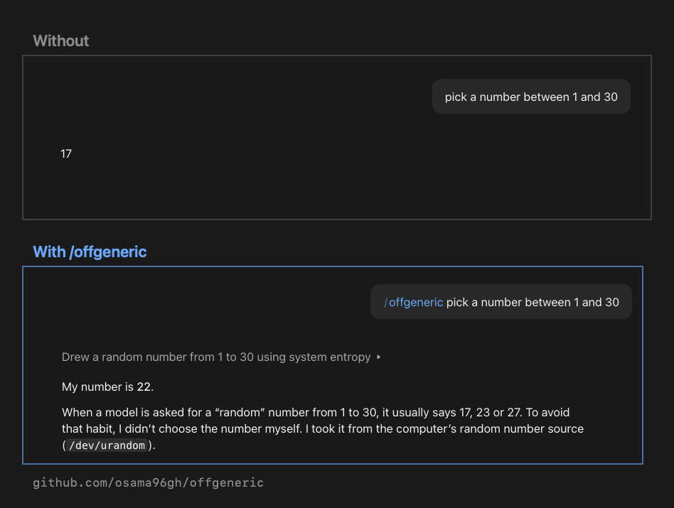

# OffGeneric

**Make AI output original instead of generic, while keeping it recognizable.**

Try it: ask any AI to pick a number between 1 and 30. It will likely say 17. Models fall into the same habits, and it's not just numbers: the same names, the same purple-gradient login page, the same ideas. Asking for "more creative" barely helps.

OffGeneric is an agent skill that pulls real seed material from outside sources on the web, mixes it into your request, and checks that the result still makes sense to a fresh reader. It has no rule about numbers. It handled the test above with its one general principle: when the model's own habit is the problem, bring in material from outside.

## Install

| Tool | Install | Update |
|---|---|---|
| **Claude Code** (recommended) | `/plugin marketplace add osama96gh/offgeneric` `/plugin install offgeneric@offgeneric` | `/plugin update` |
| **Codex, Cursor, Gemini CLI, Copilot** and other [Agent Skills](https://agentskills.io) tools | `npx skills add osama96gh/offgeneric -g` | `npx skills update offgeneric -g` |
| **Codex** (built-in installer) | `$skill-installer install https://github.com/osama96gh/offgeneric/tree/main/skills/offgeneric` | Run it again |
| **claude.ai / Claude app** | [Download `offgeneric.zip`](https://github.com/osama96gh/offgeneric/releases/latest/download/offgeneric.zip), then Customize → Skills → + → Upload a skill | Re-download and re-upload |
| **OpenAI API** | Upload the `skills/offgeneric` folder or the zip as a skill | Upload again |
| **ChatGPT / any other chat AI** | Paste [`SKILL.md`](skills/offgeneric/SKILL.md) into your custom or project instructions | Paste again |
| **Manual** | Copy `skills/offgeneric` into your agent's skills folder (e.g. `~/.claude/skills/`) | Copy again |

> Use one install method per machine. Claude Code doesn't remove duplicates, so the skill would appear twice.

## Use

In Claude Code, type `/offgeneric` followed by what you want, or just ask for something creative and the skill triggers on its own:

> Suggest 5 names for my app that monitors support chats and alerts on spikes.

> Design a login page for a meditation app as a single HTML file.

Works for names, slogans, titles, UI and visual style, logos, palettes, product ideas, stories and content angles. Not for facts, math or debugging.

## How it works

1. **Anchor**: decide what must stay recognizable (the meaning of a name, the conventions of a login page).
2. **Anti-seeds**: write down the generic answers, so nothing delivered looks like them.
3. **Seeds**: pull raw material from three outside sources: one adjacent field, one far field, a little randomness.
4. **Blend**: anchor + twist. The seed changes the result; it never replaces the meaning.
5. **Five-second test**: a reader with no context guesses what each result is. Wrong guesses are dropped.
6. **Present**: a short list, each result with its seed and source.

The rule above all: **off-generic in style, never in meaning or function.**

## Before / after

| Prompt | Without | With OffGeneric |
|---|---|---|
| Pick a number between 1 and 30 | 17 | 22, drawn from the system's random source (see the image at the top) |

<!-- More comparisons (names, login page) coming -->

## Requirements

The agent needs **web access** to pull seeds. Without it, the skill falls back to the model's memory, which is exactly the generic behavior it tries to avoid.

## License

[MIT](LICENSE)
